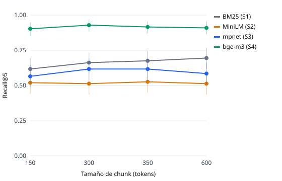
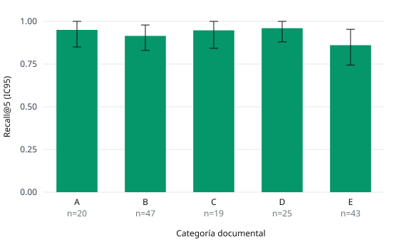

# Tablas y figuras del artículo (Revisión 3, .docx §11)

⚠️ **PRELIMINAR**: bancos de desarrollo, no el gold set. Las cifras cambiarán; la estructura no.

Fuentes: banco `banco_v32.json` · Exp. A `OE1_154` · Exp. B `exp_b_nuevos` · Exp. C `exp_c` · sistema final `E2E_B_qwen_s42_*.json`. Regenerar: `tablas/generar_tablas.py`.

## Tabla 1. Corpus y composición del banco de preguntas

| categoria | documentos | chunks | preguntas_dominio |
|---|---|---|---|
| A Gobierno y estatuto | 5 | 1612 | 6 |
| B Académico | 14 | 1684 | 7 |
| C Investigación | 7 | 524 | 4 |
| D Bienestar | 7 | 610 | 6 |
| E Laboral, docencia y políticas | 15 | 687 | 7 |
| **Total** | 48 | 5117 | 30 |

| grupo | n | detalle |
|---|---|---|
| Dominio (con respuesta) | 30 | DIRECTA 12, PROCEDIMIENTO 8, REQUISITOS 10 |
| Fuera de dominio | 6 | no vistas en desarrollo: 0 |

## Tabla 2. Recuperadores × tamaño de chunk (H1, H2; 154 preguntas)

| recuperador | chunk | n | recall@1 | recall@3 | recall@5 | recall@10 | mrr@10 | ndcg@5 |
|---|---|---|---|---|---|---|---|---|
| BM25 (S1) | 150 | 154 | 0.429 | 0.552 | 0.617 | 0.727 | 0.511 | 0.530 |
| BM25 (S1) | 300 | 154 | 0.422 | 0.571 | 0.662 | 0.773 | 0.522 | 0.549 |
| BM25 (S1) | 350 | 154 | 0.403 | 0.558 | 0.675 | 0.779 | 0.510 | 0.545 |
| BM25 (S1) | 600 | 154 | 0.409 | 0.565 | 0.695 | 0.753 | 0.515 | 0.558 |
| MiniLM (S2) | 150 | 154 | 0.279 | 0.429 | 0.519 | 0.578 | 0.372 | 0.406 |
| MiniLM (S2) | 300 | 154 | 0.260 | 0.429 | 0.513 | 0.597 | 0.359 | 0.392 |
| MiniLM (S2) | 350 | 154 | 0.279 | 0.461 | 0.526 | 0.610 | 0.380 | 0.411 |
| MiniLM (S2) | 600 | 154 | 0.279 | 0.435 | 0.513 | 0.610 | 0.374 | 0.402 |
| mpnet (S3) | 150 | 154 | 0.325 | 0.487 | 0.565 | 0.688 | 0.433 | 0.456 |
| mpnet (S3) | 300 | 154 | 0.338 | 0.500 | 0.617 | 0.714 | 0.450 | 0.484 |
| mpnet (S3) | 350 | 154 | 0.338 | 0.513 | 0.617 | 0.701 | 0.449 | 0.484 |
| mpnet (S3) | 600 | 154 | 0.331 | 0.480 | 0.584 | 0.656 | 0.431 | 0.463 |
| bge-m3 (S4) | 150 | 154 | 0.669 | 0.857 | 0.903 | 0.968 | 0.774 | 0.802 |
| bge-m3 (S4) | 300 | 154 | 0.643 | 0.870 | 0.929 | 0.961 | 0.764 | 0.805 |
| bge-m3 (S4) | 350 | 154 | 0.636 | 0.851 | 0.916 | 0.948 | 0.756 | 0.795 |
| bge-m3 (S4) | 600 | 154 | 0.662 | 0.864 | 0.909 | 0.942 | 0.769 | 0.804 |

## Figura 1. Recall@5 frente al tamaño de chunk

## Tabla 3. Generadores locales con la misma recuperación (H3)

| sistema | fidelidad (humana) | corrección (humana) | relevancia 1–5 (humana) | completitud (auto) | atrib. exacta | atrib. parcial | sin cita | latencia p50 / p95 (s) | timeouts | negativas |
|---|---|---|---|---|---|---|---|---|---|---|
| qwen | pendiente | pendiente | pendiente | 0.533 | 0.417 | 0.350 | 0.133 | 20.0 / 58.3 | 0.000 | 12/12 |
| llama32 | pendiente | pendiente | pendiente | 0.507 | 0.350 | 0.333 | 0.217 | 7.4 / 18.4 | 0.000 | 12/12 |
| qwen3 | pendiente | pendiente | pendiente | 0.631 | 0.517 | 0.333 | 0.033 | 22.1 / 25.7 | 0.000 | 12/12 |
| gemma3 | pendiente | pendiente | pendiente | 0.584 | 0.467 | 0.367 | 0.000 | 17.0 / 34.3 | 0.000 | 12/12 |

Comparaciones contra Qwen2.5-7B (Wilcoxon + Holm, IC95 bootstrap):

| métrica | comparación | diferencia | IC95 | p Holm | r | significativo |
|---|---|---|---|---|---|---|
| completitud | llama32 vs qwen | -0.026 | [-0.102, 0.048] | 0.436 | -0.221 | no |
| completitud | qwen3 vs qwen | 0.098 | [0.024, 0.181] | 0.105 | 0.617 | no |
| completitud | gemma3 vs qwen | 0.051 | [-0.029, 0.128] | 0.251 | 0.500 | no |
| atrib_exacta | llama32 vs qwen | -0.067 | [-0.200, 0.067] | 0.715 | -0.333 | no |
| atrib_exacta | qwen3 vs qwen | 0.100 | [0.017, 0.200] | 0.190 | 1.000 | no |
| atrib_exacta | gemma3 vs qwen | 0.050 | [-0.067, 0.167] | 0.715 | 0.333 | no |
| falsa_abstencion | llama32 vs qwen | -0.033 | [-0.100, 0.000] | 1.000 | -1.000 | no |
| falsa_abstencion | qwen3 vs qwen | -0.033 | [-0.100, 0.000] | 1.000 | -1.000 | no |
| falsa_abstencion | gemma3 vs qwen | -0.033 | [-0.100, 0.000] | 1.000 | -1.000 | no |
| latencia_s | llama32 vs qwen | -15.831 | [-20.384, -11.635] | 0.000 | -0.983 | sí |
| latencia_s | qwen3 vs qwen | -5.389 | [-9.817, -1.102] | 0.041 | -0.445 | sí |
| latencia_s | gemma3 vs qwen | -5.612 | [-9.841, -1.396] | 0.041 | -0.484 | sí |

## Tabla 4. Desempeño por categoría documental del sistema final (H4)

| categoria | n | recall@5 | ic95 | mrr@10 | rdoc@5 |
|---|---|---|---|---|---|
| A Gobierno y estatuto | 20 | 0.950 | [0.850, 1.000] | 0.746 | 0.950 |
| B Académico | 47 | 0.915 | [0.830, 0.979] | 0.698 | 0.936 |
| C Investigación | 19 | 0.947 | [0.842, 1.000] | 0.844 | 1.000 |
| D Bienestar | 25 | 0.960 | [0.880, 1.000] | 0.811 | 1.000 |
| E Laboral, docencia y políticas | 43 | 0.860 | [0.744, 0.953] | 0.755 | 0.930 |

## Figura 2. Recall@5 por categoría con IC95

## Tabla 5. Abstención y control de dominio (H5)

| grupo | correctas / n | tasa | IC95 Wilson | H5 (≥ 0.90) | respuestas |
|---|---|---|---|---|---|
| fuera de dominio (40) | 40/40 | 1.000 | [0.912, 1.000] | confirmada | {'M03': 26, 'M04': 14} |
| fuera de dominio no vistas en desarrollo | 0/0 | — | — | — | {} |
| ambiguas (20) | 14/20 | 0.700 | [0.481, 0.855] | no confirmada | {'M02': 6, 'M04': 7, 'M05': 4, 'M03': 3} |

## Tabla 6. Análisis de errores del sistema final

| tipo | n | % |
|---|---|---|
| recuperación fallida | 4 | 13 % |
| generación infiel | pendiente | requiere evaluación humana |
| atribución incorrecta | 1 | 3 % |
| atribución ausente | 1 | 3 % |
| atribución parcial | 11 | 37 % |
| correcta y sustentada | 13 | 43 % |

## Figura 3. Ejemplos cualitativos

Candidatos por tipo de error en `figura3_ejemplos.md`.
